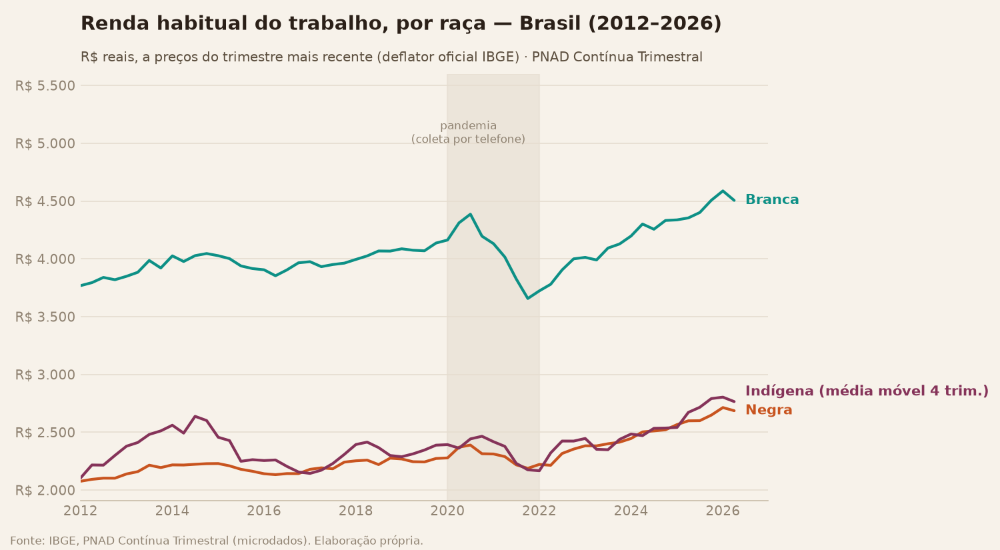
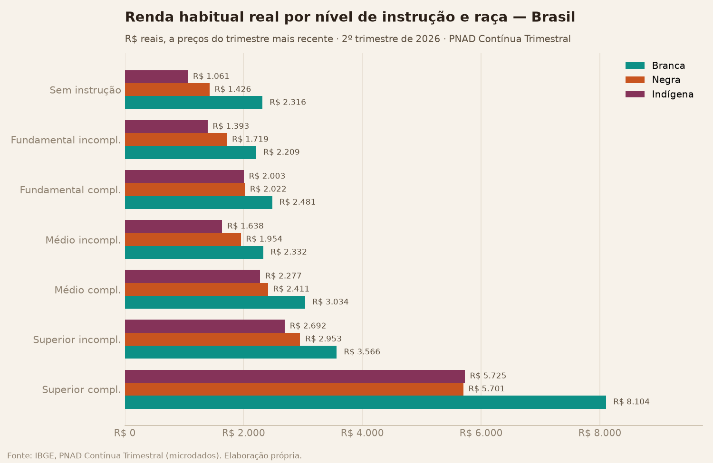
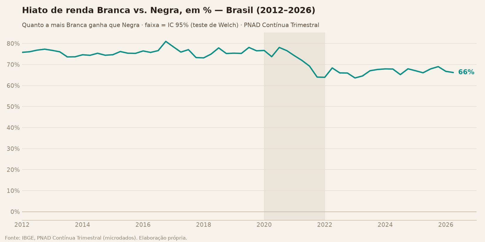
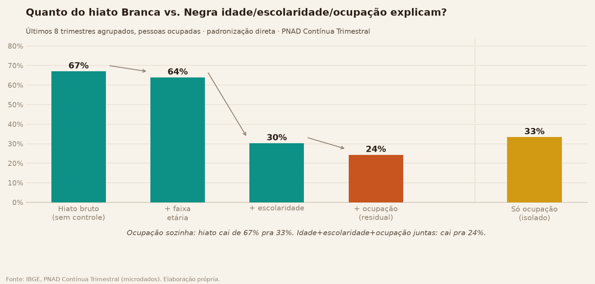
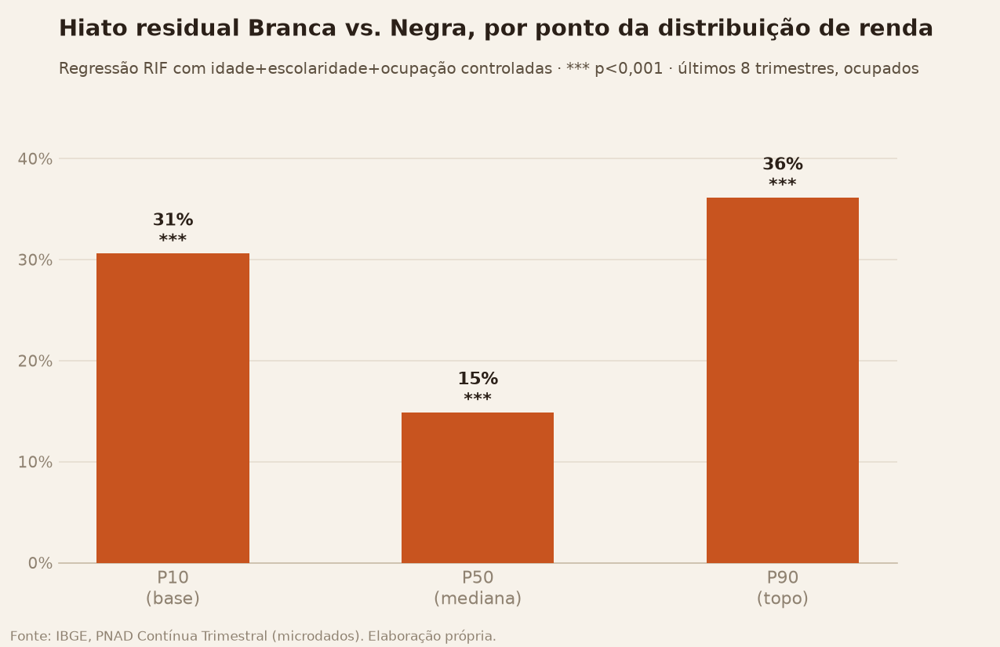
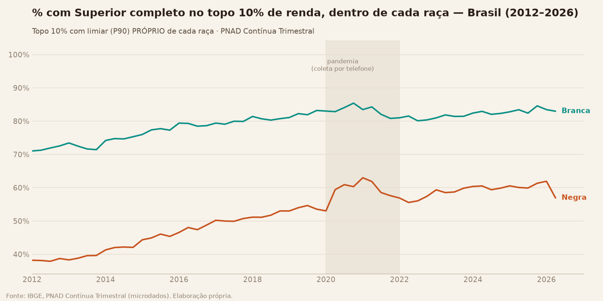
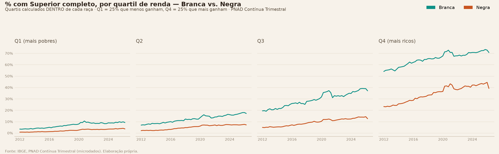
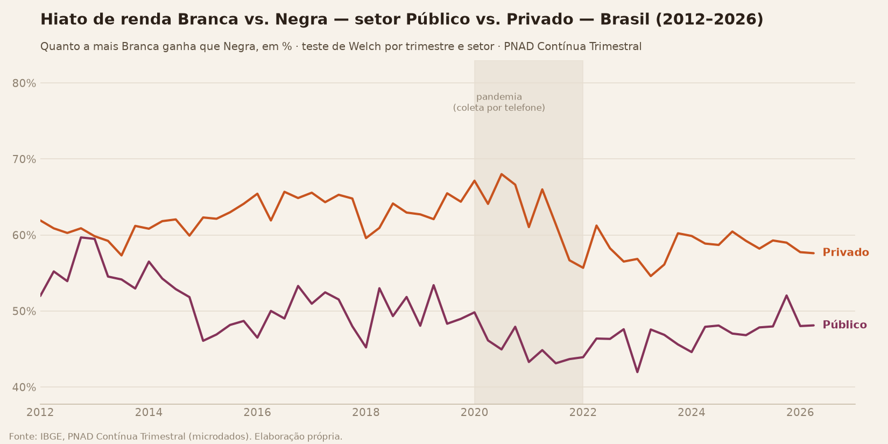
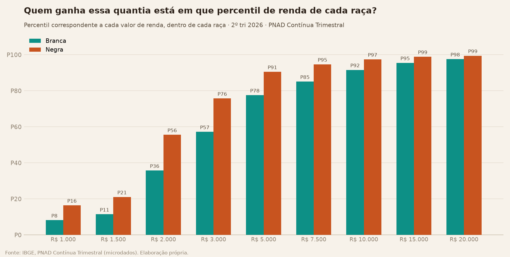

# Datahub de Análise Racial no Brasil

Datahub aberto que compara historicamente três grupos — população **negra** (preta + parda),
**branca** e **indígena** no Brasil (Amarela sempre explicitada, nunca descartada) — renda,
escolaridade, mercado de trabalho, saúde e moradia, de forma agregada e segmentada por
gênero — a partir de dados públicos (IBGE, DataSUS e outras fontes, ver roadmap).

Projeto pessoal. Plano de projeto e status em [docs/PLANO.md](docs/PLANO.md).

O projeto tem **duas árvores**:

- **A. Análises** — dados públicos → pipeline → análises → deck → dashboard
  ([docs/PLANO.md](docs/PLANO.md))
- **B. Conteúdo** — achados validados → posts para Instagram/TikTok, com planejamento de
  postagens ([conteudo/](conteudo/))

## Status

✅ **Etapa 1 (PNAD Contínua) concluída** — pipeline completo (extração da PNAD Contínua,
deflator oficial do IBGE, agregações por raça/gênero/faixa etária/geografia), análises
descritivas, decomposições, distribuição, primeira identificação causal e testes
automatizados.
⏳ **Etapas 2 a 6 e árvore de conteúdo: não iniciadas — planejadas para 2027.** Ver
[docs/PLANO.md](docs/PLANO.md).

### Renda habitual do trabalho, por raça (2012–2026)



Valores reais (deflacionados pelo deflator oficial do IBGE, a preços do trimestre mais
recente). A população indígena tem amostra pequena na PNAD Contínua — a linha usa média
móvel de 4 trimestres para reduzir ruído (ver
[docs/LIMITACOES_E_METODOLOGIA.md](docs/LIMITACOES_E_METODOLOGIA.md)).

### O hiato racial sobrevive ao controle por escolaridade



O achado mais forte da Etapa 1: o hiato de renda entre Branca e Negra/Indígena não desaparece
entre pessoas com o mesmo nível de instrução — ele se abre dramaticamente justo no topo
(Superior completo).

### Hiato Branca vs. Negra, com significância estatística



Testado (Welch, IC 95%) trimestre a trimestre a partir dos microdados: os 58 trimestres da
série são estatisticamente significativos — o hiato caiu de ~76% para ~66% entre 2012 e 2026.

### É ocupação, ou é cor da pele?



Controlando por idade, escolaridade e ocupação (mesma categoria ocupacional), o hiato bruto
de 67% cai para 24% — mas não desaparece. Boa parte do hiato racial de renda não se explica
por "estar em ocupações diferentes". Confirmado por um segundo método (regressão de
Oaxaca-Blinder, com teste de significância formal — p < 0,001): resíduo de +22%, muito perto
do resultado da padronização direta acima. E ocupação SOZINHA (sem nem controlar
idade/escolaridade) já explica quase tanto quanto as duas juntas — hiato cai de 67% pra 33%
só com essa variável. Dentro de **cada** categoria ocupacional, aliás, Branca ganha mais que
Negra — o hiato não é só "estar em ocupações diferentes".

### O hiato residual é maior no topo E na base da distribuição de renda



Decomposição por RIF (Firpo-Fortin-Lemieux): o hiato que sobra depois de controlar
idade/escolaridade/ocupação tem formato em U — menor na mediana (~15%), maior na base
(~31%, "piso pegajoso") e no topo (~36%, "teto de vidro").

### O topo 10% dos negros ficou muito mais escolarizado — mas o hiato lá em cima persiste



Olhando só pra quem está no topo 10% de renda DENTRO de cada raça (não um corte único pro
Brasil): a % com Superior completo entre os negros do topo saltou de 38% (2012) para ~58%
hoje — mas ainda fica atrás do topo dos brancos (~83%). E "faixa etária" não acompanha as
mesmas pessoas ao longo do tempo (é um corte transversal repetido) — por isso também
seguimos **gerações** (coortes de nascimento) pra ver o hiato dentro do mesmo grupo
envelhecendo, não misturado entre gerações diferentes.

### O hiato educacional se abre conforme sobe o quartil de renda



Generalizando o topo 10% pra toda a distribuição — os 4 quartis (Q1 = 25% mais pobres, Q4 =
25% mais ricos), cada um calculado DENTRO de cada raça: a diferença de escolaridade entre
Negra e Branca é de só ~6 p.p. no quartil mais pobre, mas chega a ~32 p.p. no mais rico.
Quanto mais alto na distribuição de renda, maior o hiato educacional entre as raças.

### O hiato racial é menor no setor público — mas a desigualdade tem muitas fontes



Confirma uma hipótese conhecida: como salário de concurso público segue tabela padronizada,
o hiato racial é menor lá (~45-50%) do que no setor privado (~58-68%). Ao mesmo tempo, uma
decomposição do índice de Theil mostra que só ~7% da desigualdade TOTAL de renda no Brasil
vem de diferença entre raças — os outros 93% são desigualdade dentro de cada raça. Isso não
diminui o hiato racial (que segue grande e estatisticamente significativo), mas mostra que a
desigualdade brasileira tem várias fontes ao mesmo tempo.

### R$3.000 é uma renda "do meio" pra Branca — mas quase o topo pra Negra



A mesma quantia em R$ representa posições bem diferentes conforme a raça: R$3.000 está no
P57 da distribuição de Branca (pouco acima da mediana), mas no P76 da distribuição de Negra
(perto do topo dos 25% que mais ganham dentro do próprio grupo). Na direção oposta — quanto
ganha quem está em cada percentil —, os 10% mais pobres entre os brancos ganham R$1.500,
contra R$720 entre os 10% mais pobres dos negros.

**721 gráficos ao todo.** O deck em PPTX
([docs/Datahub_Racial_Brasil_Fase1.pptx](docs/Datahub_Racial_Brasil_Fase1.pptx), ~657
slides) é organizado como uma **árvore cruzada** de renda por raça (Branca /
Negra=Preta+Parda / Indígena): 11 itens — Raça; ×Gênero; ×Faixa Etária; ×Geração;
×Escolaridade; e os cruzamentos até Raça×Gênero×[Faixa|Geração]×Escolaridade. Cada folha de
renda traz a série histórica (2012-2026); cada folha de hiato compara Branca vs. Negra e
Branca vs. Indígena, com teste de Welch. **Cada imagem aparece em exatamente um slide**, e
título, subtítulo, legenda e fonte são caixas de texto editáveis — só o gráfico é imagem.
Depois da árvore: topo 10% / base 10% / quartis com limiares em 3 escopos (Brasil inteiro /
dentro de cada gênero / dentro de raça×gênero), um ponteiro para a tabela de crescimento da
renda ([docs/tabela_crescimento_renda.xlsx](docs/tabela_crescimento_renda.xlsx), 181
linhas), Aprofundamentos e "Outras análises" — hiato por região, segregação
ocupacional/setorial (Duncan), quebra estrutural, novas variáveis (informalidade,
renda/hora, alfabetização, desalento, sobre-qualificação), Gini/Theil, hiato setor
público×privado, decomposição Oaxaca-Blinder/RIF e a função quantil da renda em R$. A
galeria narrada em [docs/ANALISE_FASE1.md](docs/ANALISE_FASE1.md) traz a leitura de cada
gráfico exploratório, incluindo Preta vs. Parda separadas.

## Escopo da Etapa 1

Fonte: PNAD Contínua Trimestral (IBGE), série histórica completa via FTP do IBGE.

- Renda, escolaridade, condição de ocupação e taxa de desocupação
- Cruzamento: Raça/Cor × Gênero × Faixa etária
- Geografia: Brasil, Grandes Regiões, UFs, Município de São Paulo, Região Metropolitana de
  São Paulo (municípios individuais do ABC Paulista não são identificáveis na PNAD Contínua
  pública — ver limitação em docs/PLANO.md; fica para a Etapa 2/Censo)

## Estrutura

```
data/
├── raw/            # microdados brutos (não versionado)
└── processed/      # datasets agregados e tratados
src/
├── ingestion/       # download e extração via FTP do IBGE
├── processing/      # limpeza, filtros, agregações (DuckDB/PyArrow)
└── utils/           # dicionários de variáveis, mapeamento de códigos
notebooks/pnad/      # exploração e validação
docs/                # árvore de análises: plano, análises, limitações, decks
tests/               # testes automatizados (pytest) das funções estatísticas
conteudo/            # árvore de conteúdo: plano, banco de pautas, calendário de postagens
```

## Como rodar

```bash
python -m venv .venv
.venv\Scripts\activate
pip install -r requirements.txt
```

Testes automatizados (round-trip de quantil, casos sintéticos de Theil e Gini, regressão
do erro padrão ponderado):

```bash
pytest tests/
```

## Roadmap

**A. Árvore de Análises**

1. ✅ **Etapa 1 — PNAD Contínua**: renda, escolaridade, mercado de trabalho (2012-2026)
2. ⏳ **Etapa 2 — Censo Demográfico 2022**: recorte abaixo do município, moradia, recorte
   indígena — planejada para 2027
3. ⏳ **Etapa 3 — Módulos anuais da PNAD Contínua**: habitação, trabalho infantil, TIC,
   outras fontes de renda — planejada para 2027
4. ⏳ **Etapa 4 — Saúde (DataSUS/SIM/SINASC/PNS)**: natalidade, mortalidade, acesso a
   serviços — planejada para 2027
5. ⏳ **Etapa 5 — Outras fontes**: violência (Atlas da Violência), encarceramento (INFOPEN),
   mercado formal (RAIS/CAGED), educação (INEP), representação política (TSE) — planejada
   para 2027
6. ⏳ **Etapa 6 — Dashboard**: publicação via Observable Framework — planejada para 2027

**B. Árvore de Conteúdo (Instagram/TikTok)** — planejada para 2027, lançamento em
21/03/2027: linha editorial, banco de pautas, produção piloto, calendário de postagens e
revisão por métricas. Ver [conteudo/](conteudo/).

Detalhes, prazos e marcos em [docs/PLANO.md](docs/PLANO.md).
