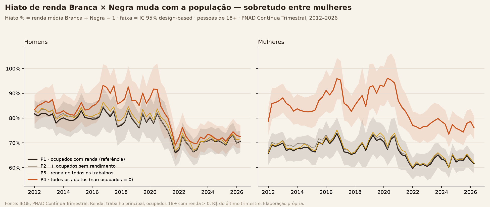
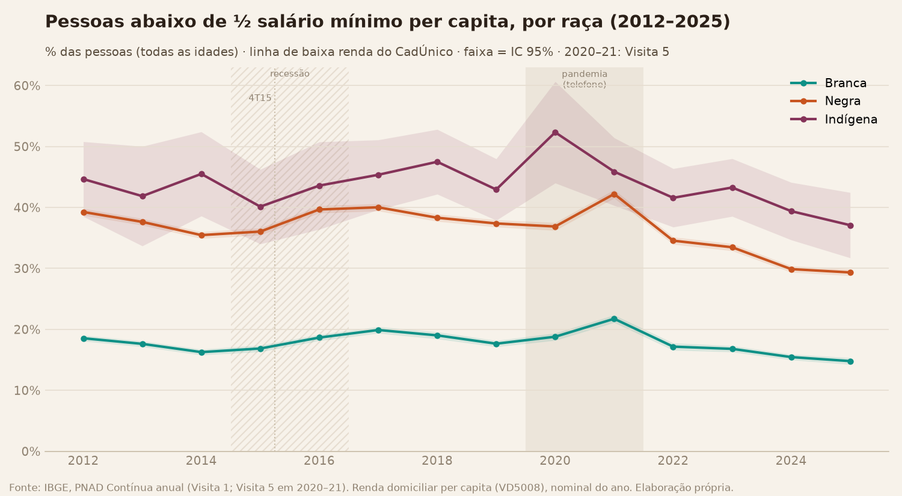
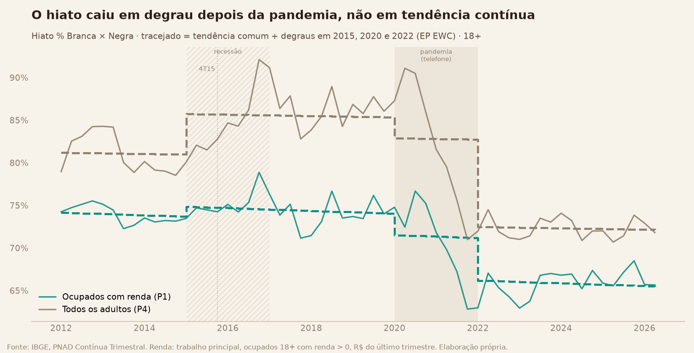
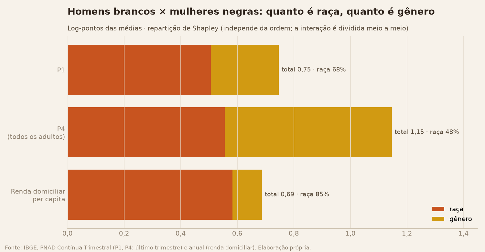

# Datahub de Análise Racial no Brasil

Datahub aberto que compara historicamente três grupos — população **negra** (preta + parda),
**branca** e **indígena** no Brasil (Amarela sempre explicitada, nunca descartada) — renda,
escolaridade, mercado de trabalho, saúde e moradia, de forma agregada e segmentada por
gênero — a partir de dados públicos (IBGE, DataSUS e outras fontes, ver roadmap).

Projeto pessoal. Plano de projeto e status em [docs/PLANO.md](docs/PLANO.md).

O projeto tem **duas árvores**:

- **A. Análises** — dados públicos → pipeline → análises → deck → dashboard
  ([docs/PLANO.md](docs/PLANO.md))
- **B. Conteúdo** — *superseded*: a produção de conteúdo (Instagram/TikTok) foi adiada para 2027
  e é gerida fora deste repositório; `conteudo/` fica só como histórico

## Status

✅ **Etapa 1 (PNAD Contínua) concluída** — pipeline completo (extração da PNAD Contínua,
deflator oficial do IBGE, agregações por raça/gênero/faixa etária/geografia), análises
descritivas, decomposições, distribuição, primeira identificação causal e testes
automatizados.
🔧 **Auditoria científica e plano de análise em andamento (out/2026).** A Rodada 1 encontrou um erro no
erro-padrão (corrigido: ver "O que é validado" abaixo e [docs/auditoria/](docs/auditoria/)). Ondas 1 e 2 do
[plano de análise](docs/PLANO_DE_ANALISE.md) concluídas, com fichas em [docs/studies](docs/studies/INDICE.md).
⏳ **Etapas 2 a 6: não iniciadas.** Ver [docs/PLANO.md](docs/PLANO.md).

> **Leitura principal (13/10/2026):** o hiato racial de renda caiu de 2012 a 2026, mas **em degrau** (−5 p.p. em
> 2022), não em tendência contínua; desde 2022 ele está plano. Toda tendência do Hub usa erro-padrão robusto a
> autocorrelação ([B1](docs/studies/B1/ficha.md)). Os gráficos de `docs/img` foram regenerados na Onda 1 com o
> erro-padrão corrigido e a população de referência.

### Renda habitual do trabalho, por raça (2012–2026)


Valores reais (deflacionados pelo deflator oficial do IBGE, a preços do trimestre mais
recente). A população indígena tem amostra pequena na PNAD Contínua — a linha usa média
móvel centrada de 4 trimestres para reduzir ruído (ver
[docs/LIMITACOES_E_METODOLOGIA.md](docs/LIMITACOES_E_METODOLOGIA.md)).

### O hiato racial sobrevive ao controle por escolaridade


O achado mais forte da Etapa 1: o hiato de renda entre Branca e Negra/Indígena não desaparece
entre pessoas com o mesmo nível de instrução — ele se abre dramaticamente justo no topo
(Superior completo).

### Hiato Branca vs. Negra, com significância estatística


Testado trimestre a trimestre a partir dos microdados, com erro-padrão que respeita o desenho
amostral da PNAD Contínua (Estrato e UPA): os 58 trimestres da série são estatisticamente
significativos (z entre 19,5 e 37,2) — o hiato caiu de 74,2% (2012 T1) para 65,7% (2026 T2), quase todo num
degrau depois da pandemia (2022), sem tendência contínua de queda ([B1](docs/studies/B1/ficha.md)). O
hiato % é **relativo à renda média Negra** (Branca ganha ~66% a mais; Negra ganha ~60% da
renda Branca). **População:** ocupados de 18+ com renda habitual do trabalho principal > 0 (desde a
Onda 1, 13/10/2026); com todos os adultos (não ocupados = 0) o hiato fica maior, sobretudo entre
mulheres — ver [`docs/studies/S1/ficha.md`](docs/studies/S1/ficha.md). A banda de IC do hiato % usa o método
delta (desde as pendências da Onda 1). Os gráficos de série marcam a recessão de 2015–16, a pandemia (coleta por
telefone, 2020–21) e a mudança do questionário de educação no 4º trimestre de 2015.

### O hiato depende de quem você olha (Onda 1)



Entre quem trabalha e tem renda, o hiato Branca × Negra é de 65,7% (2026 T2): pessoas negras ganham 60% do que
ganham pessoas brancas. Contando **todos os adultos** (quem não está ocupado entra com zero), o hiato sobe, e muito
mais entre mulheres (+17,5 p.p. em média). Pela **renda do domicílio por pessoa**, todas as idades, o hiato era de
99% em 2012 e de 82% em 2025, e 29% das pessoas negras viviam abaixo de meio salário mínimo por pessoa (15% das
brancas). Uma pessoa negra ocupada tem um terço da chance de uma pessoa branca de estar entre os 10% que mais
ganham. Fichas: [`docs/studies`](docs/studies/INDICE.md) (F, S0, S1, T, A, e S0.3, S1.3–S1.5, T4).

Quase 9 de cada 10 partes do hiato de renda do trabalho por adulto vêm da **renda por hora**; entre mulheres, 15%
vêm de estar menos ocupadas com renda ([S1.4](docs/studies/S1.4/ficha.md)). Essa desvantagem de ocupação cresceu na
recessão de 2015–16, foi máxima em 2017–19 e voltou ao nível de 2012–14 depois de 2022 ([S1.5](docs/studies/S1.5/ficha.md)).
Sem nenhuma suposição sobre quem não trabalha, nem o sinal do hiato "potencial" é identificado; supondo que essas
pessoas ganhariam entre o P10 e a média do próprio grupo, ele fica entre 24% e 136% ([S1.3](docs/studies/S1.3/ficha.md)).
Na renda domiciliar per capita, a chance de uma pessoa negra estar entre os 10% mais ricos é cerca de um quarto da
de uma pessoa branca, sem mudança desde 2012 ([T4](docs/studies/T4/ficha.md)).



### No tempo e por raça × gênero (Onda 2)



O hiato Branca × Negra entre ocupados caiu de 74% (2012) para 66% (2026), mas **em degrau**: com o erro-padrão que
respeita a autocorrelação da série, a tendência contínua não se distingue de zero e a queda vem de um salto de −5 p.p.
em 2022; desde então a série está plana ([B1](docs/studies/B1/ficha.md)). Por isso não há "data da igualdade" no
ritmo recente ([B6](docs/studies/B6/ficha.md)). Entre todos os adultos, o hiato sobe com o desemprego (+1,6 p.p. por
ponto de desocupação, [B5](docs/studies/B5/ficha.md)). A reclassificação racial existiu (mais pessoas se declaram
pretas dentro das mesmas gerações), mas não fabricou a convergência ([B2](docs/studies/B2/ficha.md)); na base da
distribuição o hiato até aumentou ([B3](docs/studies/B3/ficha.md)); quem nasceu depois de 1990 tem hiato menor na
mesma idade ([B4](docs/studies/B4/ficha.md)).



Entre ocupados, mulheres negras ganham 47% do que ganham homens brancos; cerca de dois terços dessa distância se
associam à raça e um terço ao gênero; contando todos os adultos, gênero e raça pesam quase o mesmo
([C1](docs/studies/C1/ficha.md), [C3](docs/studies/C3/ficha.md)). 14% das mulheres negras ocupadas com renda são
trabalhadoras domésticas, contra 8% das brancas ([C5](docs/studies/C5/ficha.md)).

### Quanto do hiato a ocupação explica?


Controlando por idade, escolaridade e ocupação (mesma categoria ocupacional), o hiato bruto
de 66% cai para 25% — mas não desaparece. Boa parte do hiato racial de renda não se explica
por "estar em ocupações diferentes". Confirmado por um segundo método (regressão de
Oaxaca-Blinder, com teste de significância formal — p < 0,001): resíduo de +22,8% (coeficiente
restrito, controlando por idade, instrução e ocupação), perto da padronização direta acima
(24,7%; são estimandos diferentes). O resíduo é a parte **não associada às covariáveis
incluídas**: não é medida de discriminação e não inclui região, horas trabalhadas, sexo ou
informalidade, que serão adicionados na Onda 3 do plano. E ocupação SOZINHA (sem nem controlar
idade/escolaridade) já explica quase tanto quanto as duas juntas — hiato cai de 66% pra 34%
só com essa variável. Dentro de **cada** categoria ocupacional, aliás, Branca ganha mais que
Negra — o hiato não é só "estar em ocupações diferentes".

### O hiato residual é maior no topo E na base da distribuição de renda


Decomposição por RIF (Firpo-Fortin-Lemieux): o hiato que sobra depois de controlar
idade/escolaridade/ocupação tem formato em U — menor na mediana (~15%), maior na base
(~35%, "piso pegajoso") e no topo (~34%, "teto de vidro").

### O topo 10% dos negros ficou muito mais escolarizado — mas o hiato lá em cima persiste


Olhando só pra quem está no topo 10% de renda DENTRO de cada raça (não um corte único pro
Brasil): a % com Superior completo entre os negros do topo saltou de 37% (2012 T1) para 61%
(2026 T2) — mas ainda fica atrás do topo dos brancos (84%). E "faixa etária" não acompanha as
mesmas pessoas ao longo do tempo (é um corte transversal repetido) — por isso também
seguimos **gerações** (coortes de nascimento) pra ver o hiato dentro do mesmo grupo
envelhecendo, não misturado entre gerações diferentes.

### O hiato educacional se abre conforme sobe o quartil de renda


Generalizando o topo 10% pra toda a distribuição — os 4 quartis (Q1 = 25% mais pobres, Q4 =
25% mais ricos), cada um calculado DENTRO de cada raça: a diferença de escolaridade entre
Negra e Branca é de só ~6 p.p. no quartil mais pobre, mas chega a ~30 p.p. no mais rico (2026 T2).
Quanto mais alto na distribuição de renda, maior o hiato educacional entre as raças.

### O hiato racial é menor no setor público — mas a desigualdade tem muitas fontes


O hiato racial é menor no setor público (de 42% a 59% entre 2012 e 2026; mediana 48%) do que no
privado (de 55% a 67%; mediana 60%) em todos os trimestres. Uma explicação comum é que o salário de
concurso segue tabela padronizada (hipótese, não testada aqui). Ao mesmo tempo, uma
decomposição do índice de Theil mostra que só ~7% da desigualdade TOTAL de renda no Brasil
vem de diferença entre raças — os outros 93% são desigualdade dentro de cada raça. Isso não
diminui o hiato racial (que segue grande e estatisticamente significativo), mas mostra que a
desigualdade brasileira tem várias fontes ao mesmo tempo.

### R$3.000 é uma renda "do meio" pra Branca — mas quase o topo pra Negra


A mesma quantia em R$ representa posições bem diferentes conforme a raça: R$3.000 está no
P58 da distribuição de Branca (pouco acima da mediana), mas no P77 da distribuição de Negra
(perto do topo dos 25% que mais ganham dentro do próprio grupo). Na direção oposta — quanto
ganha quem está em cada percentil —, os 10% mais pobres entre os brancos ganham R$1.500,
contra R$766 entre os 10% mais pobres dos negros (2026 T2).

**694 imagens em `docs/img`** (500 da árvore `arv_*` + 194 das demais análises, 8 da Onda 1 `onda1_*` e 8 da Onda 2 `onda2_*`; contagem de 13/10/2026, sem as séries de renda 14–17, que ficam fora das análises, e sem as 3 células da árvore sem amostra, suprimidas; a galeria
narrada em `docs/ANALISE_FASE1.md` usa 87 delas). O deck em PPTX
([docs/Datahub_Racial_Brasil_Fase1.pptx](docs/Datahub_Racial_Brasil_Fase1.pptx), 635
slides — abre com a leitura principal das Ondas 1 e 2 (18 slides); eram 657 até a Onda 1, que tirou as 37 folhas de renda 14–17, e 620 até as pendências da Onda 1, que
suprimiram 3 folhas sem amostra) é organizado como uma **árvore cruzada** de renda por raça (Branca /
Negra=Preta+Parda / Indígena): 11 itens — Raça; ×Gênero; ×Faixa Etária; ×Geração;
×Escolaridade; e os cruzamentos até Raça×Gênero×[Faixa|Geração]×Escolaridade. Cada folha de
renda traz a série histórica (2012-2026); cada folha de hiato compara Branca vs. Negra e
Branca vs. Indígena, com teste de Welch. **Cada imagem aparece em exatamente um slide**, e
título, subtítulo, legenda e fonte são caixas de texto editáveis — só o gráfico é imagem.
Depois da árvore: topo 10% / base 10% / quartis com limiares em 3 escopos (Brasil inteiro /
dentro de cada gênero / dentro de raça×gênero), um ponteiro para a tabela de crescimento da
renda ([docs/tabela_crescimento_renda.xlsx](docs/tabela_crescimento_renda.xlsx), 181
linhas), Aprofundamentos e "Outras análises" — hiato por região, segregação
ocupacional/setorial (Duncan), quebra estrutural, novas variáveis (informalidade,
renda/hora, alfabetização, desalento, sobre-qualificação), Gini/Theil, hiato setor
público×privado, decomposição Oaxaca-Blinder/RIF e a função quantil da renda em R$. A
galeria narrada em [docs/ANALISE_FASE1.md](docs/ANALISE_FASE1.md) traz a leitura de cada
gráfico exploratório, incluindo Preta vs. Parda separadas.

## Escopo da Etapa 1

Fonte: PNAD Contínua Trimestral (IBGE), série histórica completa via FTP do IBGE.

- Renda, escolaridade, condição de ocupação e taxa de desocupação
- Cruzamento: Raça/Cor × Gênero × Faixa etária
- Geografia: Brasil, Grandes Regiões, UFs, Município de São Paulo, Região Metropolitana de
  São Paulo (municípios individuais do ABC Paulista não são identificáveis na PNAD Contínua
  pública — ver limitação em docs/PLANO.md; fica para a Etapa 2/Censo)

## Estrutura

```
data/
├── raw/            # microdados brutos (não versionado)
└── processed/      # datasets agregados e tratados
src/
├── ingestion/       # download e extração via FTP do IBGE
├── processing/      # limpeza, filtros, agregações (DuckDB/PyArrow)
└── utils/           # dicionários de variáveis, mapeamento de códigos
notebooks/pnad/      # exploração e validação
docs/                # árvore de análises: plano, análises, limitações, decks
tests/               # testes automatizados (pytest) das funções estatísticas
src/inference/       # variância design-based, multiplicidade, gravação com proveniência
src/auditoria/       # inventário e relatórios antes × depois
docs/auditoria/      # auditoria científica (rodadas, linha de base, antes × depois)
conteudo/            # SUPERSEDED (histórico): conteúdo é gerido fora do repositório
```

## Como reproduzir

Requisitos: Python 3.12, ~15 GB de download do FTP do IBGE e ~2 GB livres depois da extração.

```bash
python -m venv .venv
.venv\Scripts\activate            # Linux/Mac: source .venv/bin/activate
pip install -r requirements.lock   # versões exatas testadas (requirements.txt traz os mínimos)

# 1. Microdados (baixa do FTP do IBGE; idempotente, retoma de onde parou)
python -m src.ingestion.extrator_pnadc                        # trimestral 2012-atual
python -m src.ingestion.extrator_pnadc_visita_anual           # anual, Visita 1
python -m src.ingestion.extrator_pnadc_visita_anual --visita 5 --anos 2020 2021
python -m src.ingestion.baixar_deflator

# 2. Tabelas agregadas (data/processed/*.parquet + _meta.json); ~1h30
python -m src.processing.agregacoes_pnadc
python -m src.processing.analise_causal_cotas
python -m src.processing.agregacoes_habitacao
python -m src.processing.checagem_robustez_hiato

# 3. Gráficos e decks
python -m src.processing.graficos_fase1
python -m src.processing.graficos_arvore
python -m src.processing.graficos_extremos
python -m src.processing.graficos_aprofundamentos
python -m src.processing.graficos_causal_cotas
python -m src.processing.apresentacao_arvore      # docs/Datahub_Racial_Brasil_ARVORE.pptx (só a árvore)
python -m src.processing.apresentacao_final       # deck publicado: grava docs/Datahub_Racial_Brasil_Fase1_v7.pptx;
                                                  # renomear para docs/Datahub_Racial_Brasil_Fase1.pptx
# (apresentacao_fase1 gera um deck antigo, em outro formato; NÃO sobrescreve o publicado à toa)
python -m src.processing.sensibilidade_populacao  # Onda 1: Blocos S e F (sensibilidade P1–P5, composição, heaping)
python -m src.processing.bloco_t                  # Onda 1: Bloco T (T1–T4, PNAD anual)
python -m src.processing.bloco_a                  # Onda 1: Bloco A (A2–A7)
python -m src.processing.bloco_s                  # Onda 1, pendências: S0.3, S1.3, S1.4, S1.5
python -m src.processing.graficos_onda1           # gráficos dos estudos da Onda 1 (docs/img/onda1_*)
python -m src.processing.bloco_b                  # Onda 2: Bloco B (B1–B6)
python -m src.processing.bloco_c                  # Onda 2: Bloco C (C1–C5)
python -m src.processing.graficos_onda2           # gráficos dos estudos da Onda 2 (docs/img/onda2_*)
```

Testes (rodam sem microdados, com dados sintéticos; também no CI a cada push):

```bash
python -m pytest -q
```

Para conferir que uma regeneração não mudou estimativas pontuais:
`python -m src.auditoria.antes_depois --legado <pasta em data/processed/_legado>`.

> Nota: o pipeline de produção ainda lê o extrato trimestral v1 (`data/raw/pnadc_extraido`); a
> troca para o v2 (`pnadc_extraido_v2`) acontece junto com a nova população de referência.
> NÃO VERIFICADO: reprodução completa numa máquina limpa (o CI só roda os testes).

## O que é validado

| Item | Estado | Evidência |
|---|---|---|
| Estimativas pontuais do hiato, Theil, Gini, quantis, topo/base 10% | Conferidas na auditoria Rodada 1 e idênticas após a correção de 12/10/2026 | `docs/auditoria/rodada1.md`, `docs/auditoria/antes_depois.md` |
| Erro-padrão, IC e p-valores das tabelas de hiato | **Corrigidos em 12/10/2026** (linearização com Estrato/UPA); razão linearização/bootstrap = 1,005 nos 58 trimestres | `docs/LIMITACOES_E_METODOLOGIA.md`, `checagem_robustez_hiato_racial.parquet` |
| Multiplicidade | `significativo_fdr` (Benjamini-Hochberg por família) em toda tabela com p-valor | `src/inference/multiplicidade.py` |
| Funções estatísticas | Testes automatizados, inclusive golden-file da pipeline e guarda contra a fórmula antiga | `tests/`, CI |
| Desenhos causais (cotas) | **Não validados**: resultados exploratórios; nenhum teste do Desenho B sobrevive à correção de multiplicidade | `docs/auditoria/rodada1.md` (R2, R3) |
| Decomposição Oaxaca-Blinder | Implementação correta; **especificação insuficiente** (faltam região, horas, sexo, informalidade) | R5 da auditoria |
| Gráficos com IC/asterisco | **Desatualizados** até a regeneração | `docs/auditoria/graficos_a_regenerar.md` |

## Limitações conhecidas

- **População e renda:** as tabelas publicadas hoje usam ocupados de 14+ anos e o rendimento
  habitual de **todos** os trabalhos (`VD4019`). A referência decidida é ocupados de **18+** com
  rendimento habitual do **trabalho principal** (`VD4016`) > 0; a troca está em implementação
  ([docs/PLANO_DE_ANALISE.md](docs/PLANO_DE_ANALISE.md), Bloco F).
- PNAD Contínua é corte transversal repetido (com rotação de domicílios), não painel; 58
  trimestres não são 58 evidências independentes.
- Amostra pequena de Indígena e de células finas; Amarela fora de Theil/Gini.
- Resíduo de decomposição ≠ discriminação; nenhuma conclusão causal sai das decomposições.
- Sem origem social, qualidade da escola ou território fino (Censo 2022 bloqueado).
- Detalhes: [docs/LIMITACOES_E_METODOLOGIA.md](docs/LIMITACOES_E_METODOLOGIA.md) e
  [docs/auditoria/](docs/auditoria/).

## Licença

Código sob [MIT](LICENSE). Tabelas derivadas, gráficos e textos sob
[CC BY 4.0](LICENSE-DATA.md). Os microdados são do IBGE, não são redistribuídos aqui e seguem os
termos do IBGE.

## Roadmap

**A. Árvore de Análises**

1. ✅ **Etapa 1 — PNAD Contínua**: renda, escolaridade, mercado de trabalho (2012-2026)
2. ⏳ **Etapa 2 — Censo Demográfico 2022**: recorte abaixo do município, moradia, recorte
   indígena — planejada para 2027
3. ⏳ **Etapa 3 — Módulos anuais da PNAD Contínua**: habitação, trabalho infantil, TIC,
   outras fontes de renda — planejada para 2027
4. ⏳ **Etapa 4 — Saúde (DataSUS/SIM/SINASC/PNS)**: natalidade, mortalidade, acesso a
   serviços — planejada para 2027
5. ⏳ **Etapa 5 — Outras fontes**: violência (Atlas da Violência), encarceramento (INFOPEN),
   mercado formal (RAIS/CAGED), educação (INEP), representação política (TSE) — planejada
   para 2027
6. ⏳ **Etapa 6 — Dashboard**: publicação via Observable Framework — planejada para 2027

**B. Árvore de Conteúdo (Instagram/TikTok)** — *superseded*: adiada para 2027 e gerida fora
deste repositório. `conteudo/` é mantido só como histórico.

Detalhes, prazos e marcos em [docs/PLANO.md](docs/PLANO.md).
